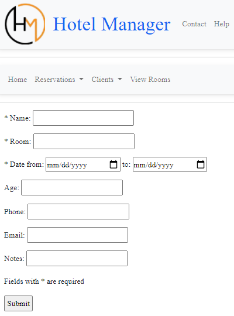

# Hotel Manager

**Hotel Manager** is a Flask web application for managing hotel reservations and customer records. It was developed by **Panos Lelakis** as an individual first-year university project in 2021.

**[Open the live demo](https://hotelmanagerlelos.pythonanywhere.com/home)**



*Reservation-entry form in the original Hotel Manager prototype.*

## Features

- Add reservations with customer details, room, arrival/departure dates and optional notes.
- Check for overlapping bookings of the same room; the departure day is excluded from occupied dates.
- View and delete reservations.
- Create customer records when reservations are added; view and delete customers after their reservations have been removed.
- Display reserved dates by room.
- Home-page visit counter, navigation help and developer contact information.

## Technology Stack

**Backend:** Python, Flask and Flask-SQLAlchemy.

**Database:** SQLite (`reservations.sqlite3`).

**Frontend:** Jinja templates, HTML, CSS and Bootstrap/MDBootstrap components.

## Local Execution

Use Python 3.12 and install the dependencies in a virtual environment:

```bash
python -m pip install -r requirements.txt
python main_app.py
```

Open **http://127.0.0.1:5000/home**. The application creates its database tables on startup when run directly. A new database starts empty; restoring existing records requires the corresponding SQLite file.

With the dependencies in `requirements.txt`, the database belongs beside `main_app.py`. Its tables are `reservation`, `client`, `room` and `webcount`. The database from this version is not interchangeable with the older plural-table version of the application.

For PythonAnywhere, import `main_app.app` through WSGI and restore or initialize the database separately. The homepage route is `/home`.

## Project Scope

This is an introductory academic prototype. It has no user authentication, allows one active reservation per customer name and has limited date validation. Reservation editing, billing and a calendar interface are outside its implemented scope.

## Acknowledgements

Development drew on Flask tutorials, W3Schools documentation and Bootstrap/MDBootstrap examples. The original report also acknowledges an architectural discussion with Grigoris Minogiannis.

## License

Available for personal study and non-commercial academic evaluation under the [Academic Evaluation Source License](LICENSE). Third-party materials retain their respective licenses and rights.
